# Flag Rehearsal

Flag Rehearsal runs the same browser journey against Current and Proposed configurations in self-hosted Flagsmith so developers can catch checkout regressions before rollout.

Two rollout rules match the same paid customer on app version 1. With **Paid plan** first, that customer gets Express and fails checkout. Moving **Older app version** first restores Classic for that customer while paid customers on version 2 keep Express.


**Toggle Wars Track 03** · [Project summary](SUBMISSION.md) · [Reproduce the regression](#reproduce-and-fix-the-regression) · [Try the independent onboarding example](#independent-example-workspace-onboarding)

<details>
<summary>Tour the checkout website from profile selection to order confirmation</summary>

**Choose a synthetic customer**

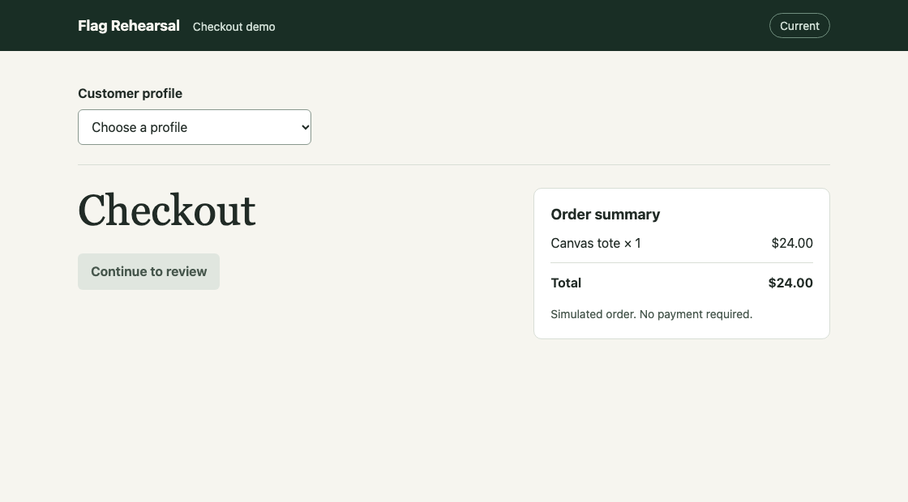

**Current · paid-older**

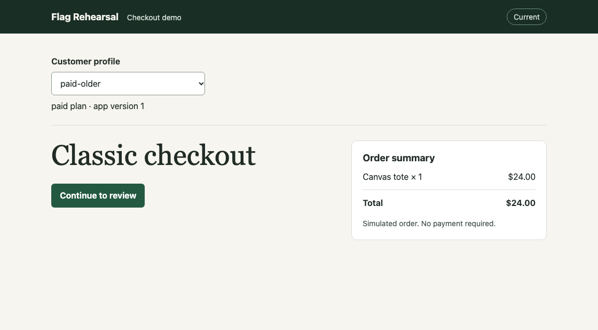

**Review the Classic order**

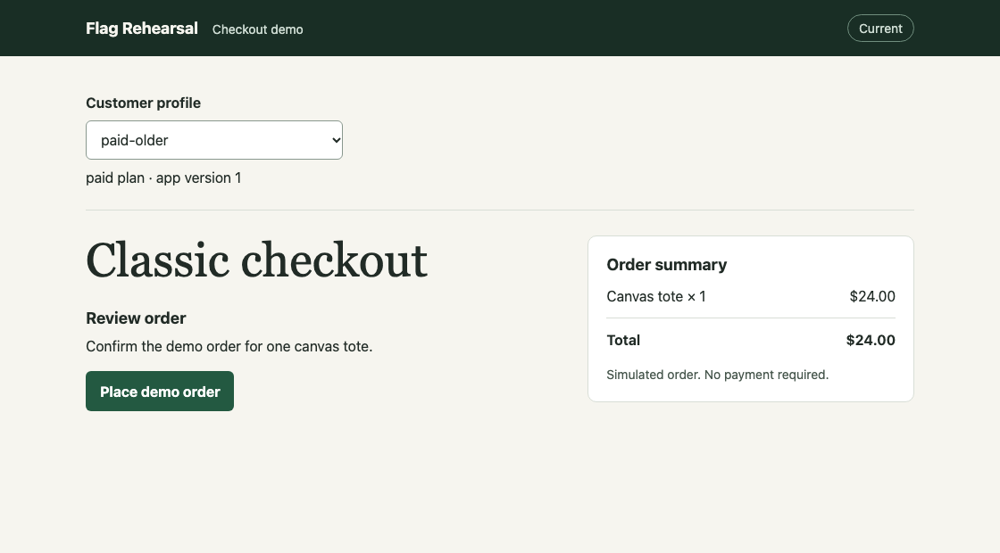

**Confirm the Classic order**

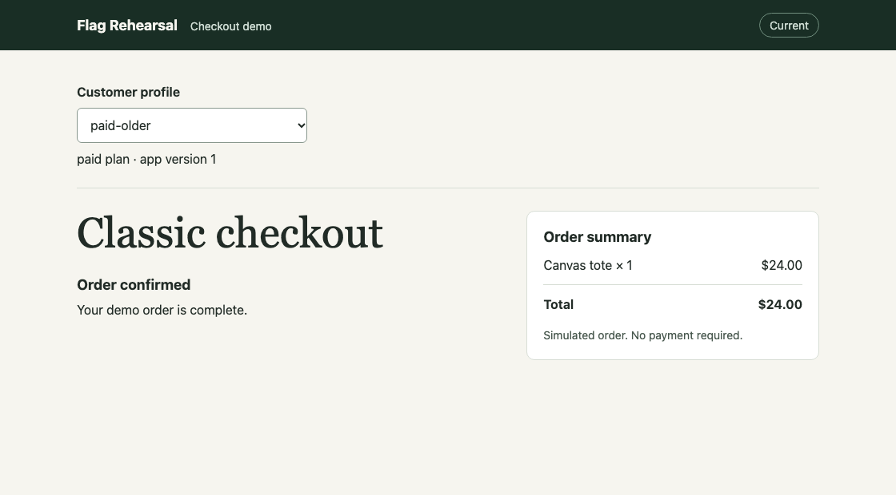

**Proposed · paid-latest**

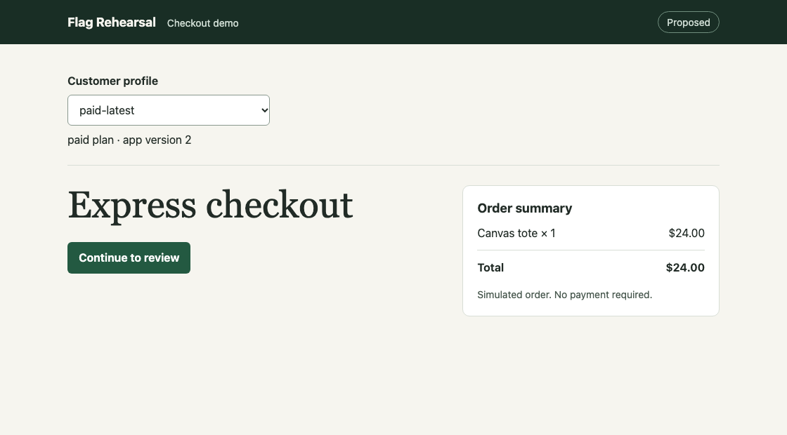

**Verify the Express session**

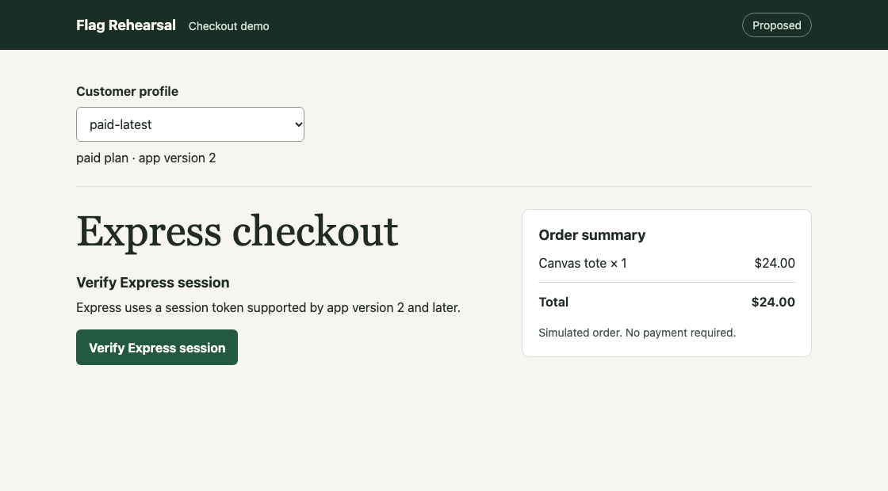

**Review the Express order**

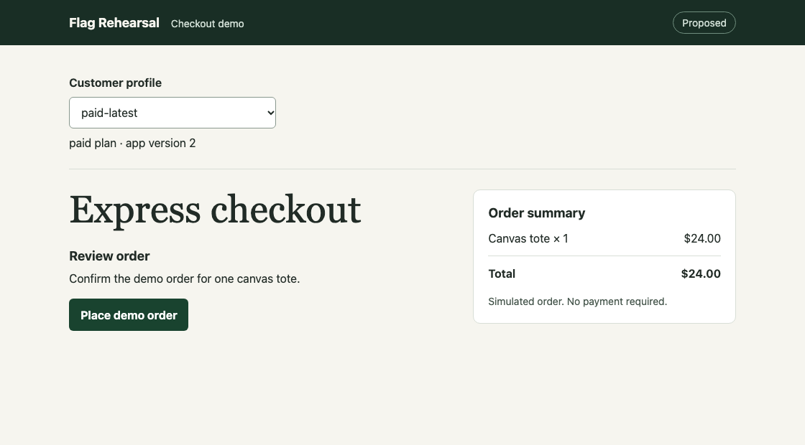

**Confirm the Express order**

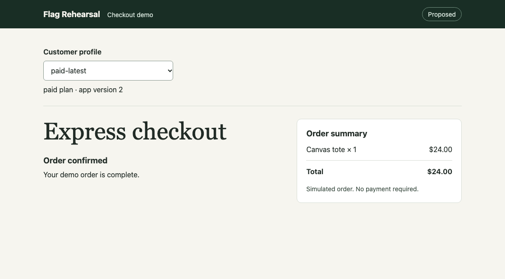

</details>

## Quick start

Install **Node.js 24 with npm** and start **Docker Engine with Compose v2.20+**. Keep ports **8000** and **4175** free. On Linux, add `--with-deps` to the Playwright install command if Chromium needs system packages.

From a fresh clone, run:

```sh
npm ci
npx playwright install --only-shell chromium
npm run setup:demo
npm run dashboard
```

- `setup:demo` creates a Git-ignored `.env` on first use, starts Compose, waits for migrations and readiness, and seeds checkout. Rerunning reuses the credentials and selects the broken demo order. Use `npm run setup:demo -- fixed` to select the fixed order.
- Compose starts Flagsmith 2.295.2 and PostgreSQL 15.18, runs migrations, and waits for the health check. Seeding creates the demo project, environments, flag, and overrides. It prints **SDK endpoint verified** for both environments and saves the client-side SDK keys to `.env`. Initial setup needs no manual Flagsmith changes. For an existing Flagsmith instance, set `FLAGSMITH_ADMIN_EMAIL` and `FLAGSMITH_ADMIN_PASSWORD` in `.env` before seeding.
- Open [Flag Rehearsal](http://127.0.0.1:4175) and click **Run Rehearsal**. The broken order shows **Current 3/3** and **Proposed 2/3**. For the same rehearsal from a terminal, run `npm run rehearse` from the project root.

[Flagsmith](http://localhost:8000) is where you change override priority. If startup fails, check `docker compose ps -a`, `docker compose logs --tail=100 postgres migrate-db flagsmith`, and `curl -fsS http://localhost:8000/health/liveness/`. If SDK keys are missing or duplicated, clear any shell or Vite mode overrides and run `npm run setup:flagsmith` to refresh `.env` while preserving the rule order.

To run alongside another copy, use `npm run init:demo -- 8016` in the fresh copy, set a unique `COMPOSE_PROJECT_NAME` in that shell, and launch the dashboard with `REHEARSAL_DASHBOARD_PORT=4185 npm run dashboard`. Use `docker compose down` to stop the stack and keep its database volume. Stop the dashboard with Ctrl+C.

<details>
<summary>See the dashboard before and during a run</summary>

**Before the first run**

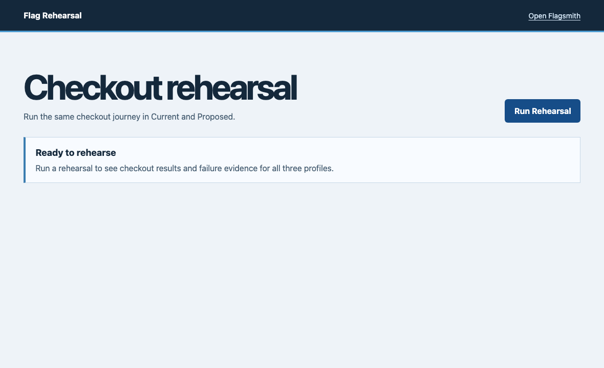

**During a rerun**

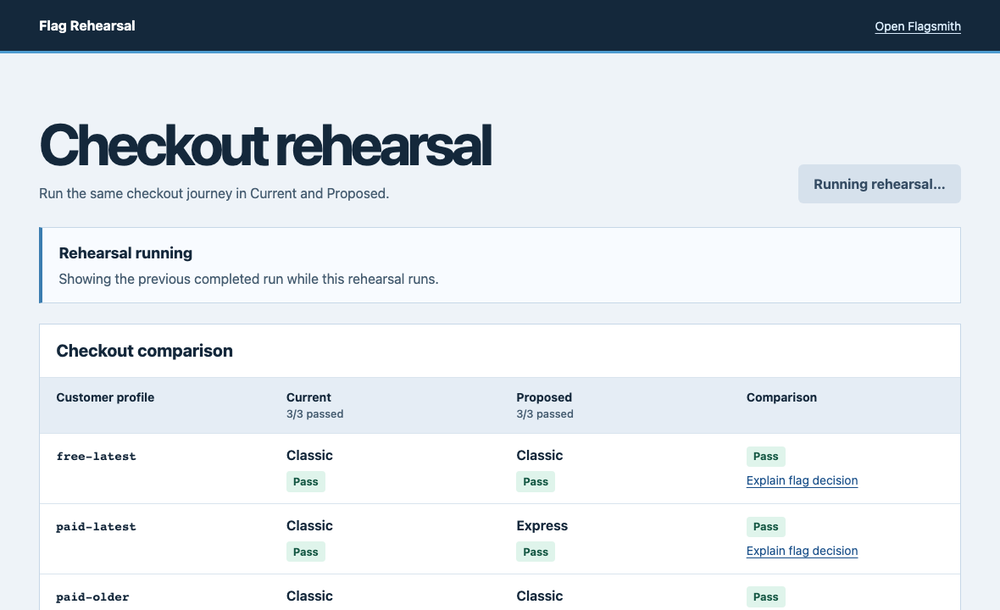

</details>

## Reproduce and fix the regression

The Boolean flag `express_checkout` defaults to **Off** in both environments. Current has no overrides. Proposed starts with two overlapping overrides in this order:

| Priority | Override | Condition | Flag |
| --- | --- | --- | --- |
| 0 | Paid plan | `plan = paid` | On |
| 1 | Older app version | `app_version < 2` | Off |

Flagsmith uses the first matching override. Both match `paid-older`, so the broken order gives that customer Express. Express requires a session capability introduced in app version 2. [Flagsmith segment precedence](https://docs.flagsmith.com/flagsmith-concepts/segments#multiple-segment-overrides-for-one-feature)

1. With the broken order, click **Run Rehearsal** or run `npm run rehearse`. In the dashboard, click **Explain this regression** for `paid-older` to see that **Paid plan** took precedence. Open the failure screenshot. **Inspect failure** shows the **Verify Express session** error and offers the Playwright trace.
2. In [Flagsmith](http://localhost:8000), sign in with the local admin credentials from `.env`. Open **Toggle Wars → Flag Rehearsal → Environments** and select **Proposed** in the left sidebar. Open **Features → express_checkout → Segment Overrides**.
3. Drag **Older app version** by its name above **Paid plan**. Keep **Older app version** Off and **Paid plan** On. Click **Update Segment Overrides** and wait for the save to finish.
4. Rerun with the same dashboard button or CLI command. To repeat, move **Paid plan** back to the top and save. The demo seed also supports `npm run setup:flagsmith -- fixed` and `npm run setup:flagsmith -- broken`.

<details>
<summary>Inspect the matching rules and the failed checkout</summary>

The Proposed flag editor lists **Paid plan** above **Older app version** before the fix.

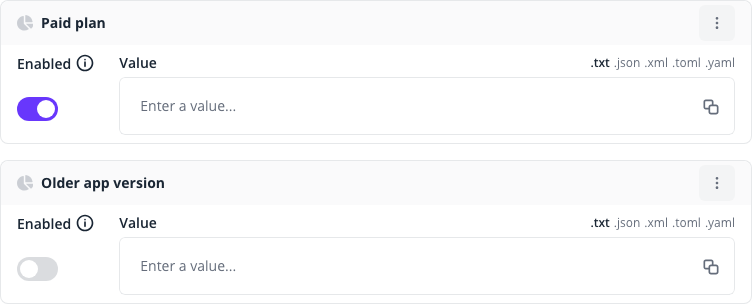

The dashboard shows the flag value in each environment and the two overrides that matched `paid-older`. **Paid plan** won in Proposed.


The browser reached **Verify Express session**, where the older client could not continue.

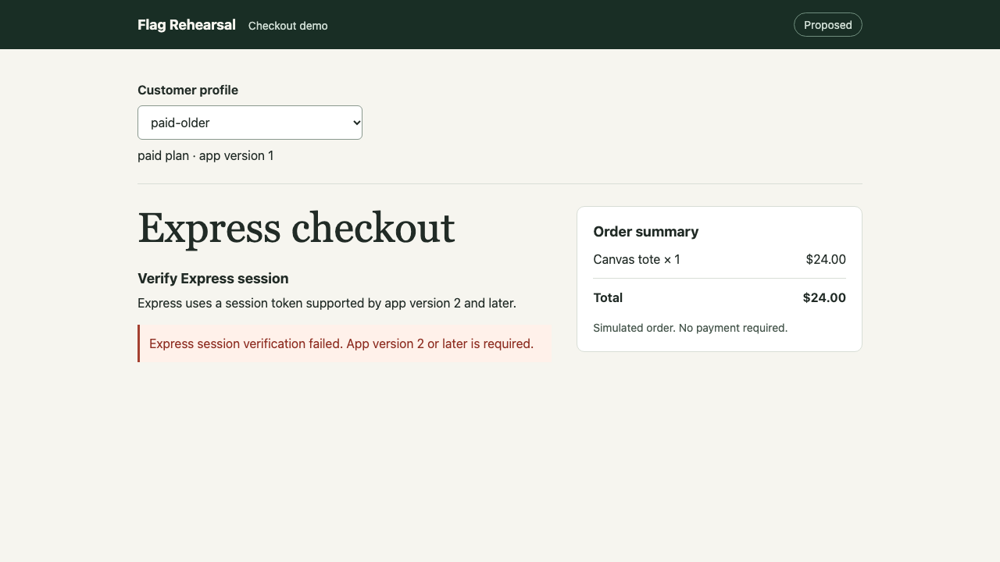

The failure inspector keeps the error, screenshot, and trace download together.

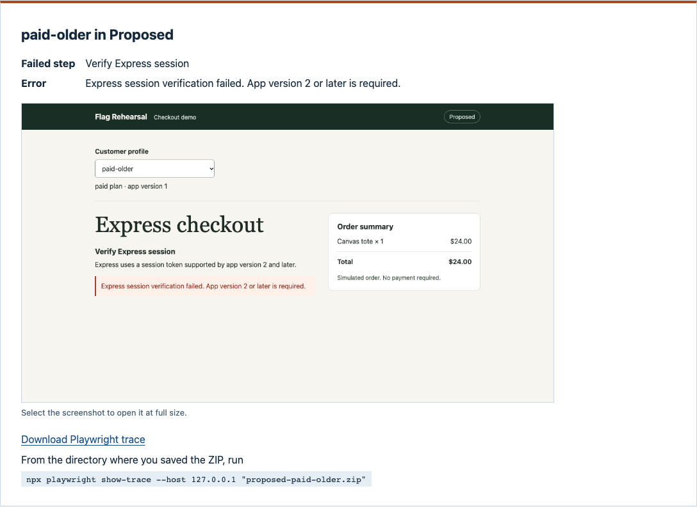

</details>

Observed on a fresh local stack:

| Profile | Traits | Current, both runs | Proposed, broken | Proposed, fixed |
| --- | --- | --- | --- | --- |
| `free-latest` | Free, app v2 | Classic · pass | Classic · pass | Classic · pass |
| `paid-latest` | Paid, app v2 | Classic · pass | Express · pass | Express · pass |
| `paid-older` | Paid, app v1 | Classic · pass | Express · fails at **Verify Express session** | Classic · pass |
| **Total** | | **3/3** | **2/3** | **3/3** |

<details>
<summary>See the dashboard after changing the rule order</summary>

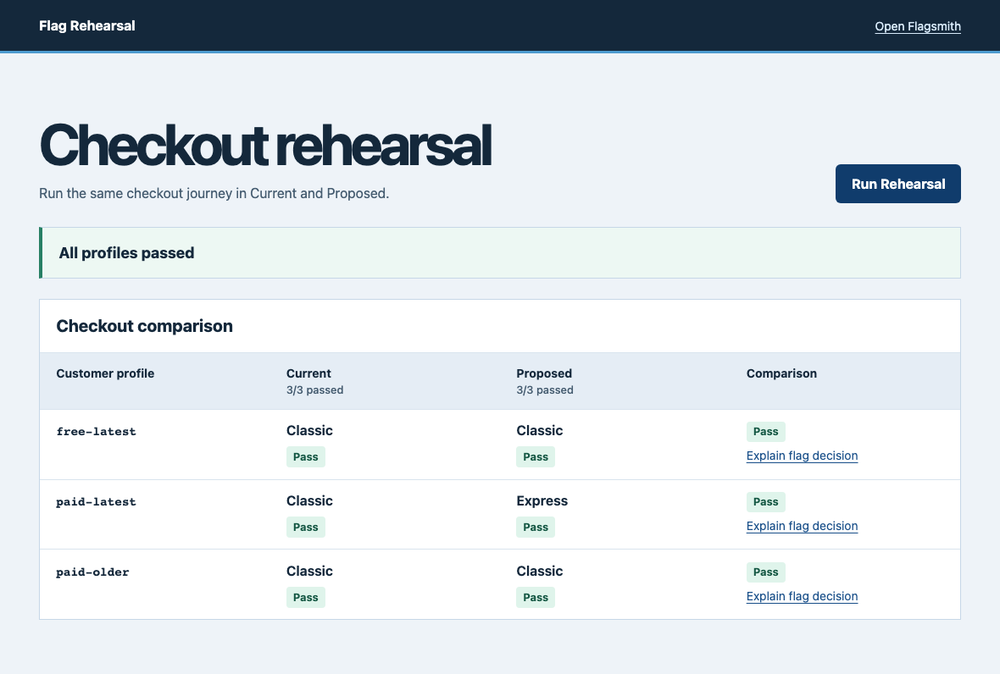

</details>

| CLI exit | Meaning |
| --- | --- |
| `0` | Both environments pass for every profile. |
| `1` | A valid comparison found a Proposed regression after a Current pass. |
| `2` | Setup failed, the comparison was incomplete, or Current was invalid. |

The CLI prints the report path. Each run keeps its own `report.json`, `summary.txt`, and any failure screenshots and trace ZIPs in `rehearsal-runs/run-*/`. To open a trace, run `npx playwright show-trace --host 127.0.0.1 path/to/trace.zip` and open the printed address if needed. The dashboard serves only evidence listed for runs it started in that session. Files remain on disk after a restart.

## How Flagsmith and the runner work

1. Playwright opens a fresh browser context for each profile and environment. The same checkout build runs twice with different client SDK keys. The app passes the selected synthetic identity, `plan`, and numeric `app_version` to the Flagsmith JavaScript SDK.
2. The SDK evaluates `express_checkout` against self-hosted Flagsmith. Checkout renders Classic for Off and Express for On. An unavailable evaluation shows a setup error.
3. Playwright reads the rendered variant, follows the checkout, and checks for **Order confirmed**. The CLI and local dashboard call the same runner, which compares outcomes and records failure evidence.

The explanation panel compares Flagsmith override snapshots taken before and after the run with the SDK’s reason and the variant actually rendered. If they cannot be reconciled, the panel keeps the observed result and shows **Cause unverified**. Use **Open saved run report** to revisit the original explanation after rerunning.

## Reuse it in another project

Run the included [flag-smoke journey](scripts/flag-smoke-journey.ts):

```sh
npm run rehearse -- flag-smoke
```

It checks the evaluated variant and order summary through the bundled previews. It does not place an order, so it can pass for a profile whose checkout fails.

To try explicit target URLs, run `npm run build`, then start `npm run start:current` and `npm run start:proposed` in separate terminals. Add this entry to `journeys` in [rehearsal.config.ts](rehearsal.config.ts), where `flagSmoke` is already imported:

```ts
'preview-smoke': {
  urls: {
    Current: 'http://127.0.0.1:4173',
    Proposed: 'http://127.0.0.1:4174',
  },
  identities: [{ id: 'paid-latest', traits: { plan: 'paid', app_version: 2 } }],
  run: flagSmoke,
},
```

Run `npm run rehearse -- preview-smoke`. For your own app, replace the URLs and synthetic identities and register a journey that applies those identities using your app’s sign-in or test interface. See the [journey contract](scripts/journey.ts) for `setup(step)`, `check(step)`, and `observe(variant)`. Journey errors record the active step. Keep customer data out of traces by using synthetic identities.

### Independent example: workspace onboarding

This separate app runs on ports 4181 (Current) and 4182 (Proposed). Its new flow saves a workspace draft and resumes after a reload. Classic finishes in one step. After the checkout quick start, launch the example in one terminal:

```sh
npm run setup:flagsmith -- onboarding-broken
npm run start:onboarding
```

In a second terminal, keep the same two app servers running:

```sh
npm run rehearse -- onboarding
# Exit 1. Enable saving for the paid cohort in Proposed.
npm run setup:flagsmith -- onboarding-fixed
npm run rehearse -- onboarding
# Exit 0. Stop the example servers with Ctrl+C in the first terminal.
```

Both flags default off. Proposed enables `new_onboarding` for Paid plan. Both environments initially enable `save_onboarding_progress` for Older app version. The fix additionally enables saving for Paid plan in Proposed. The runner records both SDK decisions in each case’s optional `observedFlags` field. The onboarding report makes no attribution to a particular matching rule.

| Profile | Current (both runs) | Proposed broken | Proposed fixed |
| --- | --- | --- | --- |
| starter (free, v2) | Classic, saving off · pass | Classic, off · pass | Classic, off · pass |
| pilot (paid, v1) | Classic, saving on · pass | New, on · pass | New, on · pass |
| team (paid, v2) | Classic, saving off · pass | New, off · **cannot save workspace progress** | New, on · pass |

<details>
<summary>Tour the independent onboarding website</summary>

**Current · Classic flow**

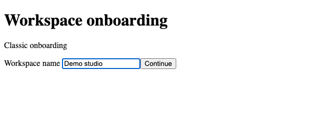

**Proposed · new flow**


**Saving disabled**

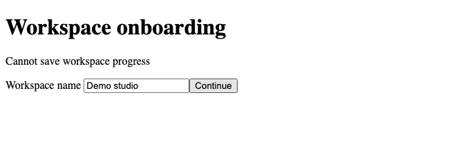

**Saving enabled**

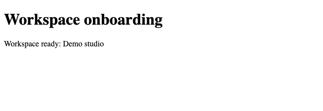

</details>

To bring your own app, copy [the onboarding journey](examples/onboarding/journey.ts), change its URLs, synthetic identities, and browser steps, then import it in [the registry](rehearsal.config.ts). The [example app](examples/onboarding/main.ts) and its [two preview servers](examples/onboarding/serve.ts) illustrate the target-side SDK integration. Checkout remains the default CLI and dashboard journey.

### CI

The [GitHub Actions workflow](.github/workflows/flag-rehearsal.yml) starts an isolated Flagsmith stack, seeds Proposed, and runs `npm run rehearse`. Pull requests use the fixed demo order. To exercise both outcomes, use **Actions → Flag Rehearsal → Run workflow** and choose `broken` or `fixed`. Any nonzero exit fails the check. The upload step runs even after failure. In the run’s **Artifacts** section, look for `flag-rehearsal-broken` or `flag-rehearsal-fixed` for the JSON report, summary, and any screenshots and traces.

This is an example check. To adapt the workflow, replace demo seeding with your Flagsmith setup, apply the candidate configuration to Proposed, and run your registered journey against the two app URLs. Keep the CLI exit status and the artifact step. For shared infrastructure, put management credentials in CI secret storage. The broken and fixed commands were verified locally against fresh self-hosted Flagsmith. Hosted execution and upload are unverified.

### Developer checks

```sh
npm run build
npm run typecheck
node --test tests/*.test.ts
npm run test:e2e
```

The browser suite uses the running seeded Flagsmith instance and checkout previews on ports 4173 and 4174.

## License

Flag Rehearsal is available under the [MIT License](LICENSE).
