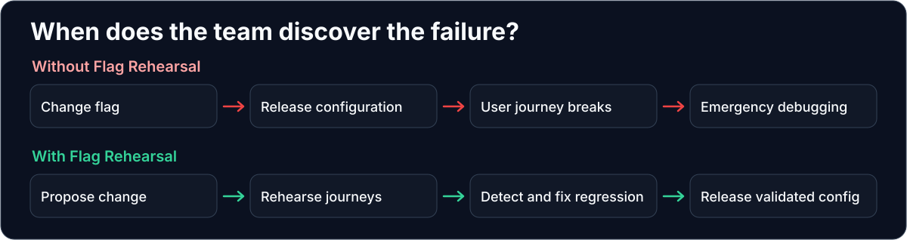
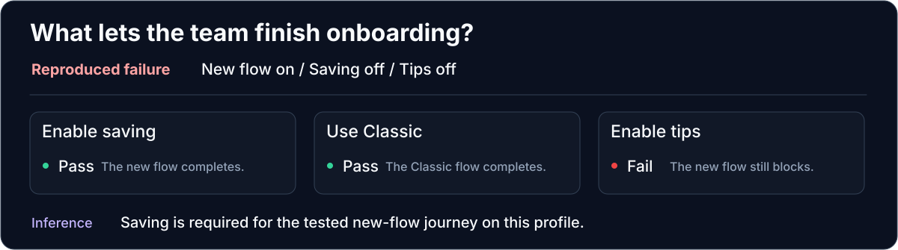
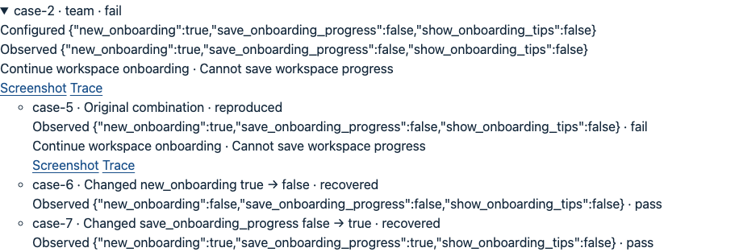
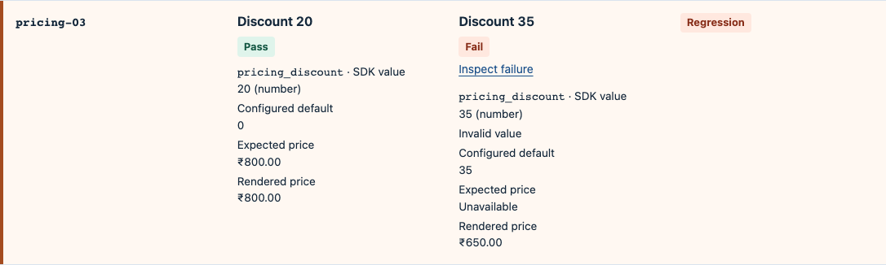
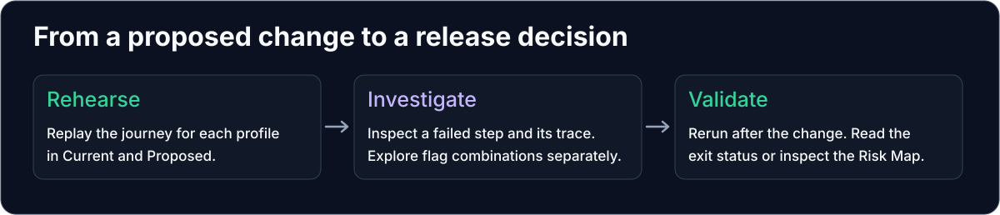
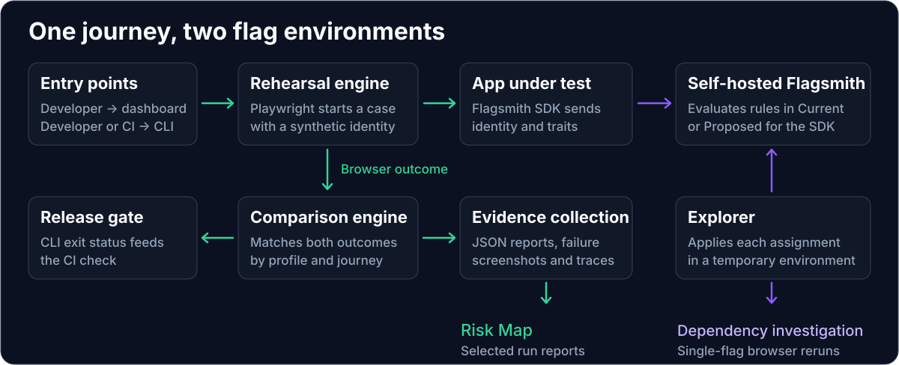

<h1 align="center"></h1>

<p align="center">
  
</p>

<p align="center">
  <a href="#overview">Overview</a> · <a href="#features">Features</a> · <a href="#quick-start">Quick Start</a> · <a href="#demo-walkthrough">Try the demo</a> · <a href="#architecture">Architecture</a> · <a href="#validation">Validation</a> · <a href="#integration">Integration</a>
</p>

## Overview

Flag Rehearsal lets developers replay a browser journey against **Current** and **Proposed** configurations in self-hosted Flagsmith to see who gets stuck, which flags they received, and whether a configuration change fixes the journey.

**Feature flags deserve the same testing rigor as code.** A rollout can break an older client even when the build is identical and both targeting rules look right. Rehearsal puts the customer's failed step, the winning rule, and the browser evidence in the same report.

From a fresh clone with Node.js 24+ and Docker running, start the demo.

```sh
npm run demo
```

Open the [local dashboard](http://127.0.0.1:4175) and click **Run Rehearsal**. [Full setup](#quick-start) · [Follow the broken-to-fixed demo](#demo-walkthrough)




### Verified results at a glance


| Check | Observed result |
| --- | --- |
| Checkout | Current stayed 3/3. Changing only Proposed rule priority recovered the older paid client. |
| Onboarding and Pricing | Current stayed 3/3 and 16/16 respectively. Enabling saving recovered the new flow. Correcting the pricing Control value recovered every tested price. |
| Explorer | Two flags yielded 4 assignments and 1 failure. Three flags yielded 8 assignments and 2 failures. Both runs verified cleanup. |
| Fresh installation and tests | One command started the dashboard on an empty database. Build, type check, 17 unit tests, 10 Playwright tests, and the local integration suite passed. |
| External application | The registered TodoMVC journey passed 1/1 on both targets in a self-run check. |
| Hosted CI | Checkout at `b34d802` produced a failed check for broken Proposed and a passing check for fixed Proposed. [Broken run](https://github.com/krishh0310/flagsmith-/actions/runs/45763576595) · [Fixed run](https://github.com/krishh0310/flagsmith-/actions/runs/45763580691) |

## Features

### 01 · Configuration rehearsal

Give both environments the same customers and the same definition of success. Checkout succeeds when the customer reaches order confirmation. The app selects Classic or Express from the SDK response. The report records the variant it rendered.


<details>
<summary>See which rule won and where checkout stopped</summary>


</details>

### 02 · Automatic Flag Combination Explorer

Which settings break onboarding together? Select flags and profiles, then preview the browser cases before running them. For `team`, Explorer generated all four assignments of `new_onboarding` and `save_onboarding_progress`. Only **new flow on + saving off** blocked progress.


With *n* Boolean flags there are **2ⁿ** assignments. The planner uses exhaustive coverage for one to three flags and pairwise coverage for four to eight registered flags. It caps a run at 16 combinations and 48 planned cases and reports uncovered pairs. The bundled Onboarding adapter exposes three flags. Pairwise and truncated plans are covered by planner tests.

Explorer writes assignments to a run-owned temporary Flagsmith environment, checks the values the app observed, and verifies disposal. **Cancel Explorer** stops an active run. After an interruption, `npm run explore -- --recover` retries cleanup from the saved ownership record. [Execution limits and recovery](docs/developer-guide.md#onboarding-and-explorer)

### 03 · Dependency investigation

Explorer first repeats a failing combination. If the failure reproduces, it changes one flag at a time and records the browser outcome for each intervention. In the three-flag run, enabling saving let `team` finish the new flow. Switching back to Classic also worked. Enabling tips alone left the customer stuck.



<details>
<summary>Inspect the dashboard evidence for the two-flag investigation</summary>



</details>

### 04 · Multivariate and remote configuration testing

The Pricing journey checks a ₹1,000 item. The approved values of `pricing_discount` are 0%, 10%, and 20%, with expected prices of ₹1,000, ₹900, and ₹800. Flagsmith assigns each identified browser a value. Playwright checks both the received value and the price the page displays.

The broken Proposed **Control** value was **35%**. Seven of 16 synthetic identities in the captured run saw **₹650**. Restoring Control to 0% brought all 16 back within the price contract. Repeated evaluations were stable within each unchanged environment. The allocation across these 16 identities can vary with a fresh environment. [Run the Pricing example](docs/developer-guide.md#multivariate-pricing)



### 05 · Flag Risk Map

Choose **Open Flag Risk Map** and select one saved report per journey. The captured map combines broken Checkout, fixed Onboarding, and broken Pricing. It evaluated **22/22 comparisons** and recommended **Hold rollout** for eight affected journey-specific profiles. Open a regression cell to reach the evidence from that run.


### 06 · CI/CD release gates

A pipeline can run the same journey as the dashboard. The included GitHub Actions job starts an isolated Flagsmith stack, runs `npm run rehearse`, and uploads the JSON report and available screenshots and traces even when the check fails. A team can require this check before merge or deployment. [CLI exits and artifact names](#integration) · [Workflow definition](.github/workflows/flag-rehearsal.yml)

## Quick Start

Install **Git**, **Node.js 24 or later with npm**, and **Docker Engine or Docker Desktop with Compose 2.20+**. Start Docker and use a POSIX shell. The default services need local ports **4175** and **8000**.

```sh
git clone https://github.com/krishh0310/flagsmith-.git
cd flagsmith-
npm run demo
```

On first launch, the command installs locked dependencies and Chromium, starts PostgreSQL and Flagsmith, waits for migrations, creates the **Flag Rehearsal** project and both environments, and seeds broken Checkout. It generates credentials and fills in the two public SDK keys in a Git-ignored `.env`. Subsequent launches preserve the saved Checkout order.

Open the [Flag Rehearsal dashboard](http://127.0.0.1:4175). **Ready to rehearse** means the dashboard is ready for its first run. The separate [Flagsmith dashboard](http://localhost:8000) is where you edit rules. To stop, press **Ctrl+C** in the demo terminal, then run `docker compose down` in the clone to retain the database. [Environment settings, port overrides, Linux browser dependencies and troubleshooting](docs/installation.md)

### Demo walkthrough

1. **Rehearse Checkout.** With **Checkout** selected, click **Run Rehearsal**. On a fresh install Current passes 3/3 and Proposed passes 2/3. To restore this starting point on a reused demo, run `npm run setup:flagsmith -- broken` in a second terminal in the clone.
2. **Inspect the regression.** On the `paid-older` row, click **Explain this regression**, then **Open failure screenshot**. **Paid plan** matched first, so Express reached **Verify Express session** on a client that lacks the required capability. **Inspect failure** also offers **Download Playwright trace**.
3. **Explore a second failure.** Open **Explore flag combinations**. Leave only `team` checked under **Profiles** and only `new_onboarding` and `save_onboarding_progress` under **Boolean flags**. Click **Preview plan → Run Explorer**, then expand **case-2 · team · fail**. Compare the original failure with the rerun that changes saving to on. Explorer uses its own temporary environment.
4. **Fix Checkout in Flagsmith.** Click **Open Flagsmith** and sign in using the local admin settings from `.env`. Open **Flag Rehearsal → Environments → Proposed → Features → express_checkout → Segment Overrides**. Drag **Older app version** above **Paid plan** by its name. Keep their values **Off** and **On**, respectively. Click **Update Segment Overrides**.
5. **Rerun Checkout.** Return to **Checkout → Run Rehearsal**. Both environments now pass **3/3**. In Proposed, `free-latest` stays on Classic, `paid-latest` keeps Express, and `paid-older` completes Classic. **View report** reopens the earlier failure with its original rule order.

<details>
<summary>See the fixed result or reproduce the two orders from a terminal</summary>


Run each line from the clone while Flagsmith is running. The first rehearsal intentionally returns exit 1.

```sh
npm run setup:flagsmith -- broken
npm run rehearse
npm run setup:flagsmith -- fixed
npm run rehearse
```

</details>

## How it works



A registered journey supplies targets, synthetic identities, and browser steps. The runner opens a fresh Chromium context for each identity in each environment. The demo app evaluates flags before allowing the journey to proceed. A missing decision produces a setup error. When a step fails, the runner captures evidence before closing the context, then compares matching profiles across environments.

### Architecture



The React dashboard calls a local Fastify API. The CLI calls the same TypeScript runner directly. Both use the same comparison rules. The Risk Map reads selected reports, so each screenshot and trace belongs to a particular journey and run. [Component responsibilities](docs/architecture.md)

### Powered by Flagsmith

- **Environment and identity.** Self-hosted Flagsmith 2.295.2 stores Current and Proposed in PostgreSQL. The same Checkout build uses the selected environment's SDK key. The official JavaScript SDK sends the identity, plan, and numeric app version.
- **Targeting and precedence.** A feature flag controls a behavior without a new deployment. Here, `express_checkout` defaults off. The segment rules `plan = paid` and `app_version < 2` both match `paid-older`. Flagsmith resolves their order. Rehearsal saves the order with the report and checks the explanation against the observed decision and UI. An unsupported explanation is labeled **Cause unverified**. [Segment precedence](https://docs.flagsmith.com/flagsmith-concepts/segments#multiple-segment-overrides-for-one-feature)
- **Remote values and exploration.** Pricing reads the weighted value assigned by Flagsmith. Explorer uses the Management API to provision, configure, and remove a temporary environment. This lets each browser exercise the actual SDK path while preserving the two rollout environments. [Management API](https://docs.flagsmith.com/integrating-with-flagsmith/flagsmith-api-overview/management-api)

## Integration

Run `npm run rehearse` for Checkout or pass the registered journey name, for example `npm run rehearse -- pricing` after seeding Pricing. The CLI writes `report.json`, `summary.txt`, and available failure evidence into a new `rehearsal-runs/run-*/` directory.

| CLI exit | Release check |
| --- | --- |
| `0` | Every matched profile passed in both environments. |
| `1` | A profile passed in Current and failed in Proposed. |
| `2` | Setup error, missing result, or invalid baseline. These take precedence over a regression. |

On GitHub, open the workflow run's **Artifacts** section. The Checkout upload is named `flag-rehearsal-broken` or `flag-rehearsal-fixed`. The integration job uploads `flag-rehearsal-integrations`. To adapt it, register your targets and identities, start any required apps, and change the check to your journey command. Keep the CLI exit status and the `always()` artifact upload. [Example workflow](.github/workflows/flag-rehearsal.yml)

### What Flag Rehearsal adds to Playwright

| Capability | In a general Playwright suite | In Flag Rehearsal |
| --- | --- | --- |
| Browser steps, screenshots and traces | Built-in primitives | Registered journeys and run-linked evidence |
| Compare environments and synthetic identities | Configure targets and match cases | Shared Current/Proposed runner |
| Exhaustive or pairwise flag coverage | Supply a generator and flag fixtures | Bounded Explorer with temporary environments |
| Investigate dependencies | Write controlled reruns | Reproduce failure, flip one flag, retain observation |
| Validate remote values | Assert against an app-specific contract | Journey records SDK values, expected and rendered prices |
| Assess release risk | Aggregate results and define a CI policy | Cross-journey map, JSON report and documented exit codes |

### Bring your own application

Register two reachable URLs, stable identities with optional traits, and a Playwright callback in the journey registry. Mark setup and assertion steps and record the variant or remote value that the app actually observed. [Registry](rehearsal.config.ts) · [Journey contract](scripts/journey.ts) · [Onboarding example and commands](docs/developer-guide.md#onboarding-and-explorer)

The external **TodoMVC** adapter exercises task creation, completion, and filtering on a pinned upstream application. After starting the two local targets as documented, run `npm run rehearse -- todomvc`. Both targets passed 1/1. This checks runner portability. Independent developer adoption remains unverified. [Reproduce the external validation](docs/real-world-validation.md)

Checkout migrations, SaaS onboarding, and weighted pricing are demonstrated here. Payment changes, gradual rollouts, enterprise overrides, and customer-segment compatibility checks are further applications for teams that register the relevant journeys and profiles.

## Validation

The dashboard captures use a clean local clone with fresh credentials and a new database. Hosted evidence covers the two earlier Checkout runs. The newer integration suite has local verification. [Commands, results and capture provenance](docs/technical-validation.md)

In three paired local trials, a scripted browser checklist took **1.320 s** at the median and Rehearsal took **1.854 s**. Both found the same regression and saved a screenshot and trace. Rehearsal also starts previews, compares profiles, and collects rule evidence. Human hands-on time remains unmeasured. [Method and raw timings](docs/benchmark.md)

<details>
<summary>View the earlier hosted Checkout checks</summary>


</details>

### Known limitations

Coverage depends on registered journeys and synthetic identities. Exhaustive coverage grows exponentially. Pairwise plans can miss higher-order interactions, and a recovered single-flag intervention supports a hypothesis only for the tested conditions. A **Hold rollout** recommendation needs a team's release policy to enforce it.

The dashboard lists runs from its current session. Reports stay on disk. Use a fresh database for repeated integration suites. On Flagsmith 2.295.2, reseeding broken Onboarding after a fixed run retains an existing **Paid plan** override. [Exact reset steps](docs/developer-guide.md#onboarding-and-explorer)

## Built for the Flagsmith Hackathon — Track 03

Flag Rehearsal extends open-source Flagsmith with a reusable dashboard and CLI for testing proposed rollouts. Teams can take a targeting rule or flag interaction, see its effect in a real browser, fix it in Flagsmith, and run the same check on their own application. [Toggle Wars](https://www.wemakedevs.org/hackathons/flagsmith) · [Submission summary](SUBMISSION.md)

## Contributing and license

For a journey or fixture change, include reproduction steps and the observed CLI exit or report. Run the build, type check, and applicable tests. [Contributor checks](docs/developer-guide.md#reports-and-checks)

Built by **Sai Krish Karthik** and released under the MIT License. [License](LICENSE) · [Upstream TodoMVC notice](examples/todomvc/LICENSE.upstream.md) · [Product logo](docs/assets/logo.svg)
