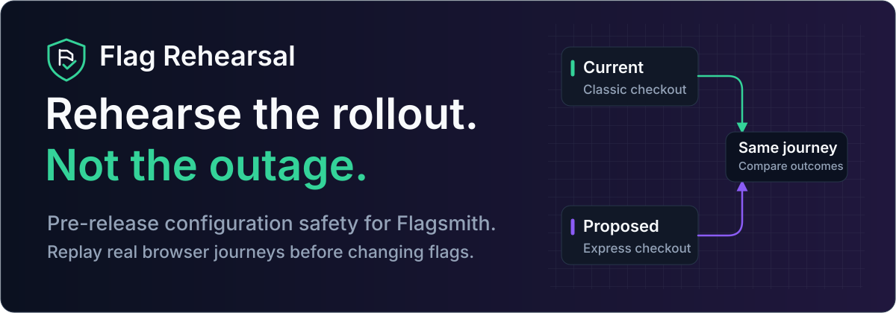
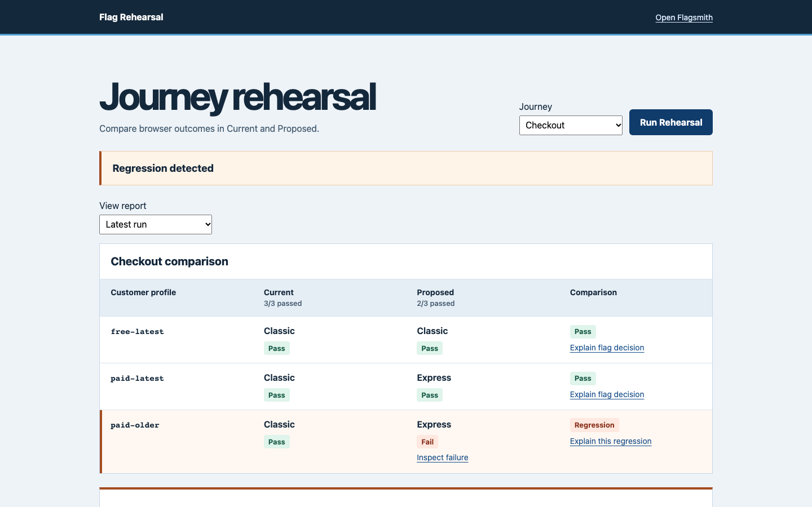
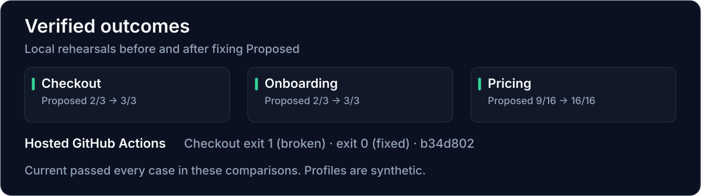
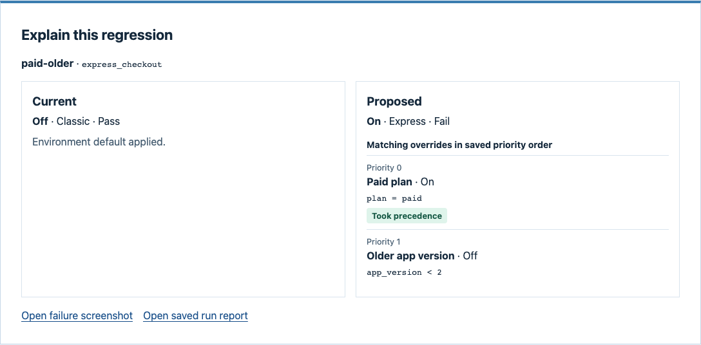
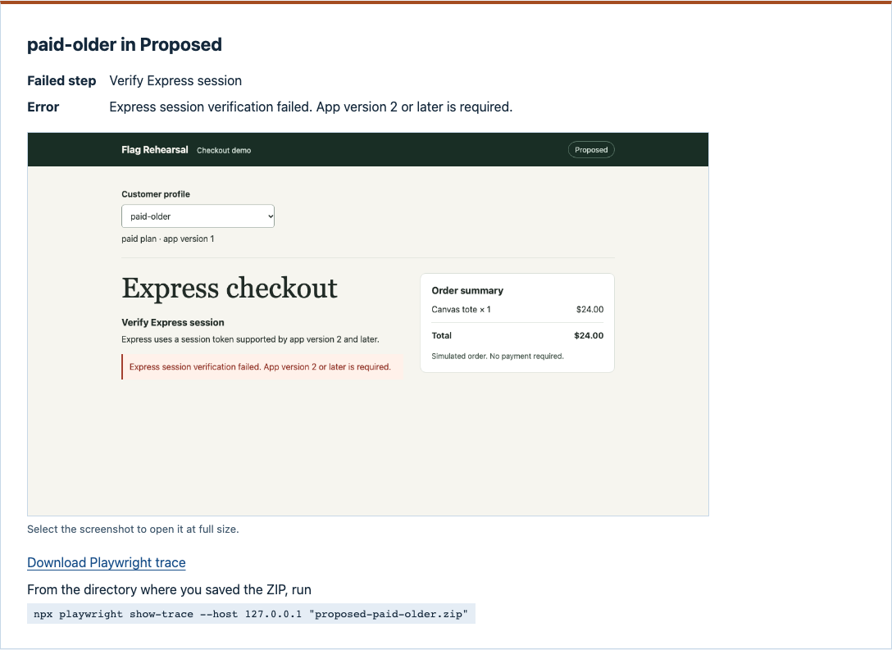
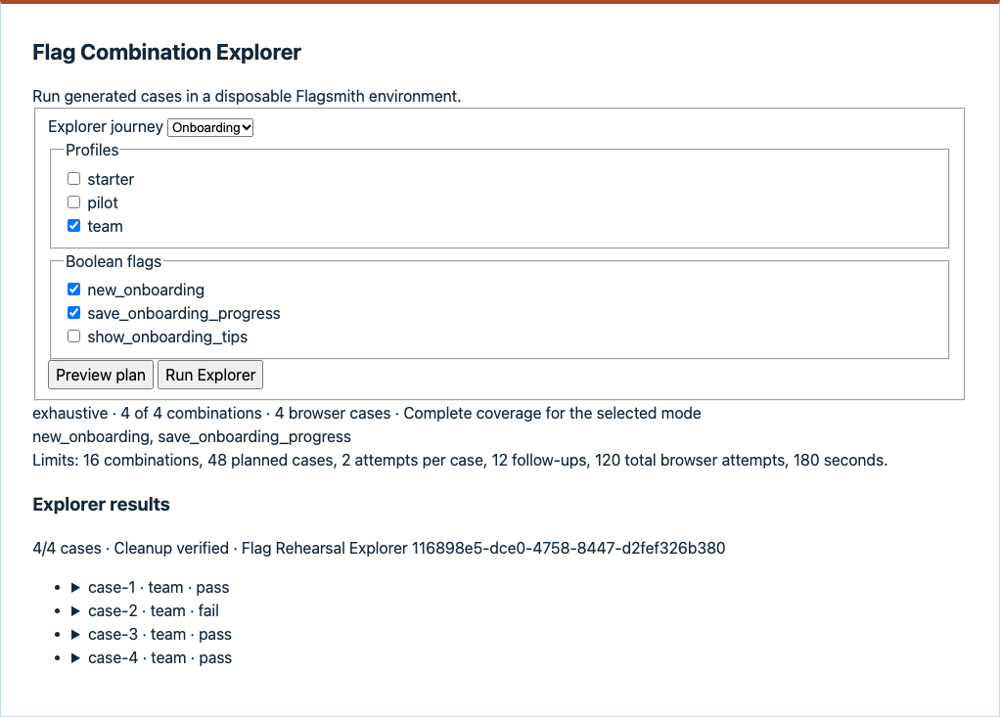
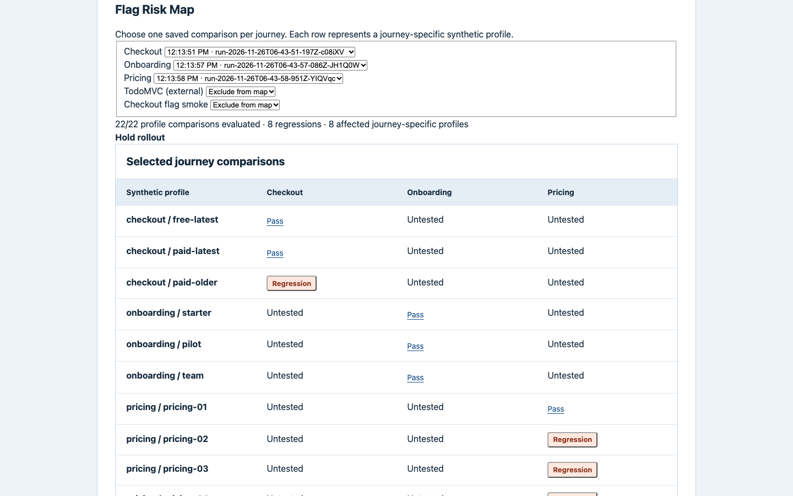
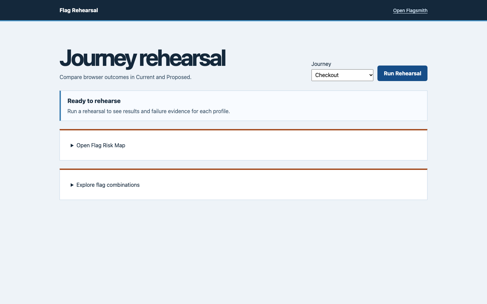
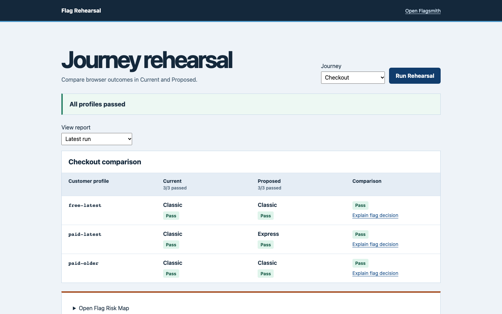
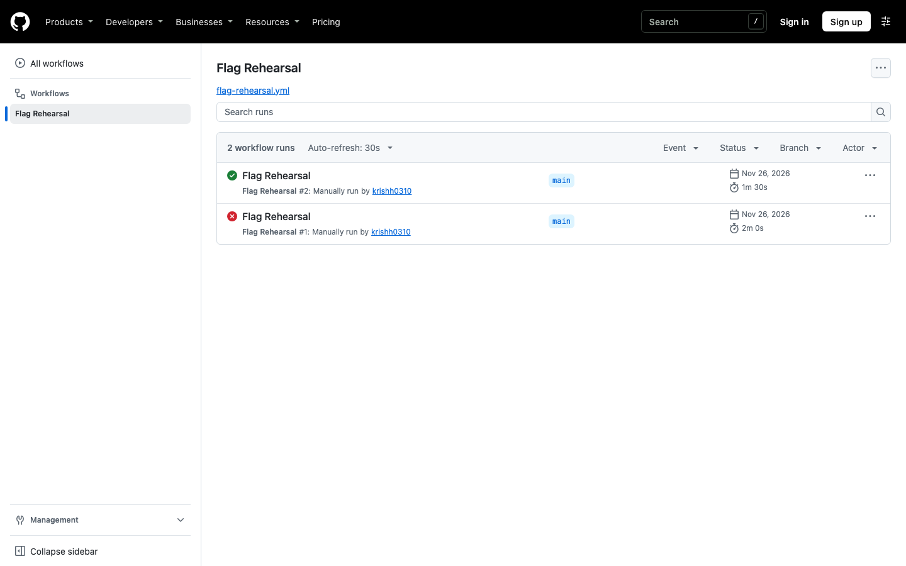

# Flag Rehearsal

<p align="center">
  
</p>

<p align="center">
  <a href="https://docs.flagsmith.com/"></a>
  <a href="https://playwright.dev/"></a>
  <a href="LICENSE"></a>
</p>

[Overview](#overview) · [Features](#features) · [Quick Start](#quick-start) · [How It Works](#how-it-works) · [Architecture](#architecture) · [Validation](#validation) · [Integration](#integration)

## Overview

Flag Rehearsal helps engineering teams run the same browser journey against Current and Proposed configurations in self-hosted Flagsmith, so they can see which synthetic customers would hit a regression, where it happens, and which rules explain it.

A feature flag can change who gets a feature without deploying new application code. In the Checkout demo, the proposed Express rollout gives a paid customer on an older client a checkout flow that their app cannot complete. Flag Rehearsal catches the failure in Chromium and shows which targeting rule won.

**[Run the local demo](#quick-start)** · [See the 60-second walkthrough](#60-second-walkthrough)




### Results at a glance



The numbers count synthetic profiles in the demonstrated runs. Pricing allocations can differ across independently seeded environments. [Verification commands and earlier runs](docs/technical-validation.md)

## Features

### Configuration rehearsal

Run identical Playwright journeys for the same synthetic identities in Current and Proposed. The application uses the real Flagsmith SDK. The comparison identifies regressions, invalid baselines, and setup errors. For Checkout, the explanation shows which matching segment override took precedence and links to the failed step, screenshot, and trace.

<details>
<summary>Inspect the rule explanation and browser evidence</summary>





</details>

### Automatic Flag Combination Explorer

A set of `n` Boolean flags has `2^n` assignments. Preview the plan before running it. The engine uses exhaustive plans for up to three flags and pairwise plans for larger registered sets. It reports uncovered pairs when limits truncate a plan. The bundled Onboarding adapter exposes three flags. The [developer guide](docs/developer-guide.md) documents planning and execution limits.

Explorer runs in a disposable Flagsmith environment, checks that SDK observations match the applied values, and saves browser evidence. It supports cancellation, verifies disposal, and can recover interrupted runs with an ownership record. The captured two-flag run tested all four combinations for `team` and found one failure. The three-flag test ran all eight and found two failures.



### Dependency investigation

Explorer repeats the failing input and then changes one flag at a time. In Onboarding, **New flow on + Saving off** failed for `team`. Turning saving on recovered the new flow. Switching to Classic also recovered the journey, while enabling tips alone still failed in the three-flag run. These observations support a saving dependency for the tested profile and journey.


<details>
<summary>View the investigation in the dashboard</summary>


</details>

### Multivariate and remote configuration testing

Pricing checks a ₹1,000 base price against approved discounts of 0%, 10%, and 20%. Flagsmith supplies the received value for each synthetic identity, and Playwright validates the price displayed by the app. The broken Proposed Control value of 35% rendered **₹650**. Restoring 0% returned Proposed to **16/16 passing**. The assignment probe confirmed repeat observations within each unchanged environment.

<details>
<summary>View the rejected discount and rendered price</summary>


</details>

### Flag Risk Map

Select one saved run per journey to build a map of profile comparisons. The dashboard reports how many comparisons were evaluated and how many synthetic profiles regressed. Open a cell to inspect Current and Proposed outcomes and retrieve their original evidence. The example below combined broken Checkout, fixed Onboarding, and broken Pricing.



### CI/CD release checks

Use the CLI exit status as an input to a release workflow. The included GitHub Actions Checkout job fails when a Proposed regression occurs and uploads reports, screenshots, and traces when available. A team can use the check in its own merge or release policy. [Workflow](.github/workflows/flag-rehearsal.yml)

## Quick Start

Use **Node.js 24+ with npm**, **Git**, a POSIX shell, and a running Docker Engine or Docker Desktop with **Compose 2.20+**. Keep ports **4175** and **8000** free.

```sh
git clone https://github.com/krishh0310/flagsmith-.git
cd flagsmith-
npm run demo
```

The command installs locked dependencies and Chromium, starts self-hosted Flagsmith and PostgreSQL, waits for migrations, and seeds the Checkout sample. It creates a Git-ignored `.env` with local credentials and SDK keys.

Open the [local dashboard](http://127.0.0.1:4175), keep **Checkout** selected, and click **Run Rehearsal**. Stop the dashboard with **Ctrl+C**, then run `docker compose down` to stop Flagsmith and retain its database. [Installation, configuration, and troubleshooting](docs/installation.md)

<details>
<summary>Preview the dashboard before the first run</summary>



</details>

### 60-second walkthrough

1. Run **Checkout** on the seeded broken configuration. **Current** passes 3/3 and **Proposed** passes 2/3.
2. On the `paid-older` row, click **Explain this regression**, then **Open failure screenshot**. The **Paid plan** override sent the older app to Express, where it failed **Verify Express session**.
3. Click **Open Flagsmith** and sign in with the local admin settings from `.env`. Open **Flag Rehearsal → Environments → Proposed → Features → express_checkout → Segment Overrides**. Drag **Older app version** by its name above **Paid plan**, then click **Update Segment Overrides**. Keep their values **Off** and **On**, respectively.
4. Return to the dashboard and click **Run Rehearsal** again. Both environments pass **3/3**. `paid-older` now completes Classic while `paid-latest` keeps Express. The rule order was the only change.

To restore the broken sample, run `npm run setup:flagsmith -- broken` from the repository root with Flagsmith running.

<details>
<summary>View the repaired Checkout comparison</summary>



</details>

## How It Works


The same application build evaluates flags using the environment’s client-side SDK key and the selected synthetic identity. Playwright starts a fresh Chromium context per case. The runner compares each profile’s Current and Proposed outcomes, keeps evidence, and returns the comparison to the dashboard or CLI.

## Architecture


React and Fastify provide the local dashboard. The TypeScript registry associates each journey with target URLs, profiles, and Playwright steps. The shared runner produces the comparison. Explorer adds a guarded management path for temporary environments. [Component responsibilities](docs/architecture.md)

## Powered by Flagsmith

Self-hosted Flagsmith supplies separate **Current** and **Proposed** environments. The Checkout SDK sends a synthetic identity with plan and app-version traits. Flagsmith evaluates segments, applies override precedence, and returns the flag decision. Pricing uses the same SDK to read multivariate values. Explorer uses the Management API to create, change, and remove only its disposable environment. [Flagsmith segments and precedence](https://docs.flagsmith.com/flagsmith-concepts/segments#multiple-segment-overrides-for-one-feature) · [Flagsmith Management API](https://docs.flagsmith.com/integrating-with-flagsmith/flagsmith-api-overview/management-api)

## Integration

Run the CLI from the repo root with Flagsmith running:

```sh
npm run rehearse
```

| Exit | Meaning |
| --- | --- |
| `0` | All comparisons passed. |
| `1` | A journey passed in Current and regressed in Proposed. |
| `2` | Setup failed or the comparison was incomplete or invalid. |

Reports and failure artifacts are written to `rehearsal-runs/`. Use **View report** for previous dashboard runs in the same session. The GitHub Actions workflow uploads available artifacts even when a comparison fails.

### What the runner adds to browser tests

| Capability | A general browser suite | Flag Rehearsal |
| --- | --- | --- |
| Browser journeys and evidence | Browser automation and traces | Uses Playwright |
| Flag comparison and synthetic targeting | Configure targets and identities per suite | Registers one journey for both environments |
| Boolean combinations and investigation | Implement a planner and interventions | Generates bounded plans and verifies single-flag reruns |
| Remote values, risk, and CI | Write assertions and reporting | Records values, compares outcomes, and returns a CI exit code |

### Bring your own application

Register Current and Proposed URLs, a set of synthetic identities and traits, and a Playwright callback. Checkout, SaaS Onboarding, and Pricing are demonstrated here. The same pattern can be applied to payment changes, enterprise overrides, and legacy-client compatibility. The TodoMVC adapter passed 1/1 on both targets in a self-run validation against a pinned upstream revision. Independent developer review remains open. [Journey registry](rehearsal.config.ts) · [Developer guide](docs/developer-guide.md) · [External application validation](docs/real-world-validation.md)

## Validation

- **Local.** A clean-source quickstart ran the real dashboard for the screenshots above. The candidate’s Checkout, Onboarding, Pricing, Explorer, and Risk Map have local verification evidence. [Detailed results and reproducible commands](docs/technical-validation.md)
- **Hosted.** Both Checkout outcomes ran on GitHub Actions at `b34d802`. The broken job failed at rehearsal and uploaded the report, screenshot, and trace. The repaired job passed. The newer integration suite was run locally. [Broken hosted run](https://github.com/krishh0310/flagsmith-/actions/runs/45763576595) · [Fixed hosted run](https://github.com/krishh0310/flagsmith-/actions/runs/45763580691)
- **Timing.** In three paired local trials, the median was 1.320 s for a scripted browser checklist and 1.854 s for Rehearsal. The runner was slower in this comparison. Its added work includes systematic comparison and rule evidence. Human hands-on timing remains open. [Benchmark method and measurements](docs/benchmark.md)

<details>
<summary>View the two hosted Checkout results</summary>



</details>

## Project structure and contributing

- [`src/`](src/) contains the dashboard and Checkout app.
- [`scripts/`](scripts/) contains the CLI, runner, analysis, and setup.
- [`examples/`](examples/) contains Onboarding, Pricing, and the pinned TodoMVC adapter.
- [`docs/`](docs/) contains installation, architecture, and validation evidence.

For changes to a journey or flag fixture, include reproduction steps and the observed CLI exit or report. Run the applicable build, type check, and tests. [Contributor checks](docs/developer-guide.md#reports-and-checks)

## Known limitations

Coverage depends on the journeys and synthetic identities supplied. Pairwise mode can miss higher-order interactions. A verified single-flag recovery applies to the tested configuration, and a Risk Map recommendation requires an external policy to block release. Dashboard report selection is session-scoped, with artifacts retained on disk. Run the integration suite on a fresh demo database. On Flagsmith 2.295.2, the broken Onboarding seed preserves an existing Paid plan override after a fixed run. [Reset details](docs/developer-guide.md#onboarding-and-explorer)

## Built for the Flagsmith Hackathon — Track 03

Flag Rehearsal extends self-hosted open-source Flagsmith with a reusable dashboard, CLI, and release check. Teams can rehearse changes to targeting and remote values in a browser before exposing them to users. [Toggle Wars Track 03](https://www.wemakedevs.org/hackathons/flagsmith) · [Submission summary](SUBMISSION.md)

## Credits and license

Built by **Sai Krish Karthik**. Flag Rehearsal is released under the MIT License. The TodoMVC example preserves its upstream attribution. [MIT License](LICENSE) · [TodoMVC notice](examples/todomvc/LICENSE.upstream.md) · [Reusable project logo](docs/assets/logo.svg)
