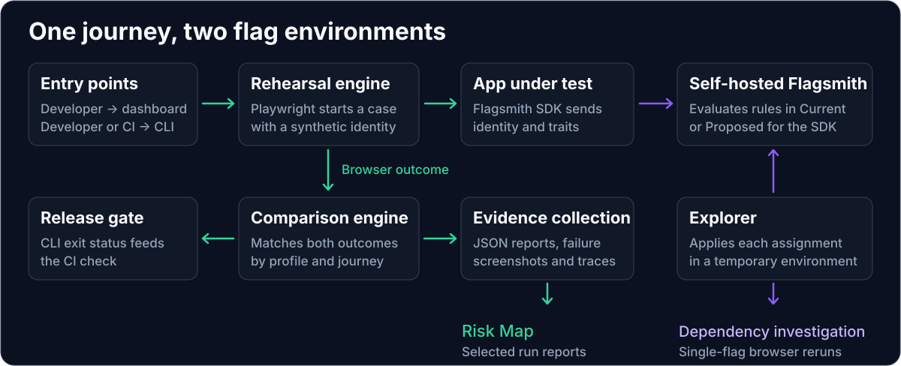

# Architecture

| Component | Responsibility |
| --- | --- |
| React dashboard and Fastify API | Select a registered journey, display a saved comparison, run Explorer, and serve run-associated artifacts. |
| CLI and GitHub Actions | Run the same comparison and use exit 0 for a passing comparison, 1 for a regression, and 2 for incomplete or invalid comparisons. |
| Journey registry | Supply target URLs, synthetic identities, optional traits, and Playwright steps. |
| Application and Flagsmith SDK | Evaluate the actual configured flags and render the enabled experience or remote value. |
| Rehearsal engine | Start a fresh Chromium context per case, record observed outcomes, and compare matching profiles across environments. |
| Explorer and investigation | Generate plans, apply flags only to a run-owned temporary environment, verify observed values, rerun failed combinations, and verify cleanup. |
| Evidence and Risk Map | Keep reports, screenshots, and traces on disk. The Risk Map aggregates explicitly selected comparisons and ties each artifact to its originating run. |

Ordinary Current and Proposed rehearsals read flag configuration and browser outcomes. Explorer uses the Management API to create a disposable environment in the bootstrapped project. It verifies environment ownership before writes and confirms removal during cleanup. The Checkout explanation compares saved rule snapshots with the SDK decision and rendered result. When the evidence cannot support a rule attribution, the UI shows **Cause unverified**.

The Risk Map can recommend **Hold rollout**. In CI, the example Checkout workflow applies the CLI exit status to a GitHub Actions check. A merge or deployment block depends on the repository's own policy.

[Back to Flag Rehearsal](../README.md)
